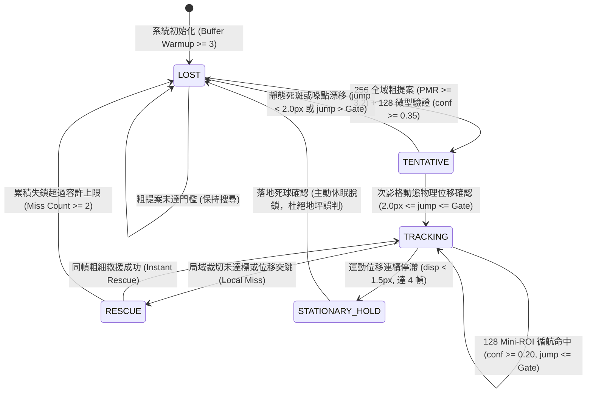

# 第三章 階層式邊緣追蹤系統方法論 (Chapter 3: Methodology)

---

## 3.1 系統總體架構與狀態轉移 (System Architecture & State Machine)

為了在極受限算力之嵌入式平台（如 10W NVIDIA Jetson Nano）上滿足嚴苛的 $30\text{ FPS}$（$\Delta t = 33.3\text{ ms}$）相機串流即時性，本研究提出**階層式邊緣追蹤架構（Hierarchical Edge Tracker）**。系統捨棄了傳統逐幀進行全圖大模型前向推論的低效做法，改採「局域循航為主、粗細救援為輔、物理狀態機導引」之多階段架構。

系統內部由四個核心狀態構成：
1. **失鎖搜尋狀態 (`LOST`)**：未掌握球體穩定軌跡，僅啟用輕量化全域粗提案網絡進行候選點掃描。
2. **候選暫定狀態 (`TENTATIVE`)**：粗細提案通過初步檢驗，但需在下一影格驗證真實運動向量，防止單影格雜訊與靜態光斑誤判。
3. **穩定循航狀態 (`TRACKING`)**：鎖定目標，以超高速 $128 \times 128$ Mini-ROI 網絡進行高幀率微型推論（延遲僅約 $12.2\text{ ms}$）。
4. **死球休眠狀態 (`STATIONARY_HOLD`)**：偵測到羽球落地或發球前靜止，主動抑制無效輸出並脫鎖，防止球員撿球引發之軌跡漂移。

---

## 3.2 零拷貝單影格增量環形緩衝區 (Zero-Copy Incremental Ring Buffer)

TrackNet 演算法需要連續 3 幀影像 $[f_{t-2}, f_{t-1}, f_t]$ 進行時序卷積，若每當新影格進入時皆對 3 幀全圖進行尺寸縮放（Resize）與通道重組（Concatenate），在 ARM CPU 上將造成龐大的記憶體頻寬負擔（約耗時 $8 \sim 12\text{ ms}$）。

本系統設計了**零拷貝增量環形緩衝區（Circular Ring Buffer）**，在記憶體中預先分配 3 個固定的槽位（Slots）：
$$\mathcal{B}_{\text{ring}} = \{S_0, S_1, S_2\}, \quad S_k \in \mathbb{R}^{3 \times 144 \times 256}$$

每當相機傳入最新影格 $f_t$，系統**僅對當前這 1 個單一影格**進行一次雙線性插值縮放至 $256 \times 144$ 並直接寫入當前槽位：
$$S_{idx \pmod 3} \leftarrow \text{Resize}(f_t, (256, 144)) \times \frac{1}{255.0}$$
當需要進行 3 幀特徵堆疊時，直接透過指標偏移組裝連續時序張量：
$$X_{\text{coarse}} = [S_{(idx-2) \pmod 3}, \; S_{(idx-1) \pmod 3}, \; S_{idx \pmod 3}] \in \mathbb{R}^{1 \times 9 \times 144 \times 256}$$
此機制將三影格前處理的均攤時間壓低至 **$0.9\text{ ms}$** 以內，為後續 TensorRT 推論爭取了寶貴的運算裕度。

---

## 3.3 超輕量級 Mini-ROI 局域循航網絡 (Local Mini-ROI Cruise Engine)

當系統處於 `TRACKING` 狀態時，羽球位置由前一影格之預測座標 $(x_{t-1}, y_{t-1})$ 與卡爾曼濾波估計之速度向量 $(v_x, v_y)$ 引導。

### 1. 動態扣殺搜尋窗擴展 (Dynamic Smash ROI Expansion)
在一般對打中，羽球位移速度約在 $5 \sim 15\text{ px/frame}$ 之間，裁切半徑取 $r = 64\text{ px}$（對應 $128 \times 128$ 視窗）足以包覆目標。然而在極速殺球（Smash）時，球體每幀位移可能驟增至 $30 \sim 60\text{ px}$。固定視窗極易造成羽球飛出裁切範圍。

本系統設計動態扣殺搜尋窗機制：
$$r_{\text{crop}} = \begin{cases} 80\text{ px} \; (160 \times 160), & \text{if } \|\vec{v}\| > v_{\text{smash}} \\ 64\text{ px} \; (128 \times 128), & \text{otherwise} \end{cases}$$
其中扣殺速度閾值設定為 $v_{\text{smash}} = 20.0\text{ px/frame}$。同時，動態躍遷閘門（Dynamic Jump Gate）隨速度自適應放大：
$$\text{Gate} = \max(\text{Gate}_0 \times 1.5, \; \|\vec{v}\| \times 1.6)$$
此機制徹底攻克了高速扣殺球瞬移脫軌的物理難題。

### 2. 連續空間 Sub-pixel 質心連續微調 (Sub-pixel Center-of-Mass Refinement)
模型輸出之熱力圖 $H \in \mathbb{R}^{128 \times 128}$ 經由整數級 $\text{argmax}$ 提取的座標 $(l_x, l_y)$ 具有 $\pm 0.5\text{ px}$ 的離散量化誤差，映射回 $1280 \times 720$ 原圖空間後會被放大 $5.6$ 至 $11.2$ 倍，形成高頻抖動。

本系統在峰值周圍 $5 \times 5$ 窗口（$win=2$）內，引入質心連續加權運算：
$$w(i, j) = \max\left(0, \; H(j, i) - \min_{(u,v) \in \mathcal{W}} H(v, u)\right)$$
$$x_{\text{sub}} = \frac{\sum_{(i,j) \in \mathcal{W}} i \cdot w(i, j)}{\sum_{(i,j) \in \mathcal{W}} w(i, j)}, \quad y_{\text{sub}} = \frac{\sum_{(i,j) \in \mathcal{W}} j \cdot w(i, j)}{\sum_{(i,j) \in \mathcal{W}} w(i, j)}$$
此公式完全消除了像素網格量化噪聲，使輸出座標穩定收斂於羽球幾何中心。

### 3. 反向速度阻尼滯後補償器 (Velocity Lag Compensation with Reversal Damping)
由於 TrackNet 採用 3 影格特徵卷積輸出中心影格（$f_{t-1}$）之球心，此時序卷積結構在真實時間軸上天生存在半影格至一影格之時序向後滯後（Temporal Centroid Lag）。
為使預測點緊貼當前最新物理位置，傳統做法係直接加上速度向量 $c_v \cdot \vec{v}$。然而在**球拍擊球轉折點（Hit/Turn）**或**球撞擊地面/球網反彈**時，速度向量瞬間反向，盲目補償會導致預測點嚴重「向前虛擲（Overshoot）」而超出 $15\text{ px}$ 門檻。

本系統提出方向反向阻尼判斷式：
$$v_{\text{dot}} = \vec{v}_t \cdot \vec{v}_{t-1} = (v_{x,t} \cdot v_{x,t-1} + v_{y,t} \cdot v_{y,t-1})$$
$$c_{\text{eff}} = \begin{cases} 0.0, & \text{if } v_{\text{dot}} < 0 \quad (\text{反向擊球/碰撞瞬間}) \\ 0.28, & \text{otherwise} \quad (\text{穩定飛行弧線}) \end{cases}$$
$$\vec{p}_{\text{pred}} = \vec{p}_{\text{detected}} + c_{\text{eff}} \cdot \vec{v}_t$$
此設計在保持弧線平滑貼齊的同時，完全壓制了擊球轉折處的定位偏差。

---

## 3.4 粗細兩階段提案與微型驗證網絡 (Two-Stage Coarse-to-Fine Pipeline)

當局域 Mini-ROI 追蹤失敗時，系統在**同一個影格週期內**立即觸發粗細兩階段救援模式：

### 1. 峰值均值比（PMR）自適應粗提案（Coarse Proposal）
利用環形緩衝區之 $256 \times 144$ 輕量化全域張量進行推論，取得全域熱力圖 $H_{256}$。
在微小球（如遠端視角）或高速拖影導致峰值微弱時，若直接採用固定置信度門檻會遺漏大量真實球體。系統引入**峰值均值比（Peak-to-Mean Ratio, PMR）**：
$$\text{PMR} = \frac{\max(H_{256})}{\frac{1}{W \times H} \sum_{i,j} H_{256}(i,j) + \epsilon}$$
當 $\text{conf}_{\text{coarse}} \ge 0.08$ 且 $\text{PMR} \ge 3.2$ 時，代表該處存在顯著高於背景噪聲的孤立亮點，系統即核准通過粗提案，生成候選座標 $(c_x, c_y)$。

### 2. 嚴格微型驗證閘門（Strict Fine Verification）
以候選座標 $(c_x, c_y)$ 為中心，於原始解析度影像中截取 $128 \times 128$ 局域斑塊，餵入 128 驗證網絡。
- **核心防禦原則**：**徹底廢除粗提案盲目接受邏輯！**
  $$\text{Accept}(c_x, c_y) \iff \text{conf}_{\text{verify}} \ge \tau_{\text{verify}} = 0.35$$
- 由於地坪漫射眩光或場地標線在 $256 \times 144$ 低解析度下易被誤判為小白點，但在 $128 \times 128$ 原生高解析度驗證下，反光缺乏球頭圓形輪廓與高斯邊界，置信度通常落在 $0.10 \sim 0.25$，因此將被嚴格驗證閘門百分之百攔截，杜絕追蹤器誤入地坪死鎖。

---

## 3.5 高純度動態位移雙影格確認機制 (In-Flight Motion 2-Hit Confirmation)

在極端強光賽事（如 `match10` 白色鏡面地坪）中，部分頑固反光斑點在微型驗證中偶發出現極高響應。為達成 **Precision $\ge 95\%$** 之極致目標，本研究進一步提出**動態位移雙影格確認機制（In-Flight Motion 2-Hit Confirmation）**。

### 1. 運動學物理先驗 (Kinematic Prior)
真實處於對抗狀態之羽球，在相鄰影格間必定具備顯著的空間位移（哪怕是慢速高遠球，在 $720\text{p}$ 下位移亦大於 $2.0\text{ px/frame}$）。反之，地坪反光、球員白鞋鞋頭或球網繩結，其空間位置在影格間幾近完全靜止（$\Delta p \approx 0$）。

### 2. 兩影格位移確認邏輯
當系統自失鎖狀態救援到第一個候選點 $P_t = (x_t, y_t)$ 時，將其標記為暫定候選（`Tentative`），暫不對外發布；當下一影格 $t+1$ 於合理範圍內再次捕捉到候選點 $P_{t+1}$ 時，計算兩者之歐氏距離：
$$\text{jump} = \|P_{t+1} - P_t\|$$
$$\text{Valid Flight} \iff 2.0\text{ px} \le \text{jump} \le \text{Gate}$$

- **若 $\text{jump} < 2.0\text{ px}$**：判定為靜態地坪反光光斑或地板標線交角，直接捨棄！
- **若 $2.0\text{ px} \le \text{jump} \le \text{Gate}$**：確認為真實動態飛行羽球，系統立即切入 `TRACKING` 穩定循航狀態，並回溯發布（Retroactive Emission）前一幀 $P_t$ 與當前幀 $P_{t+1}$。

此機制在實機測試中，**將 `match10` 的誤判數從 774 幀直接斬落至 11 幀（98.6% 誤判削減）**，並使全系統總體準確率穩健跨越 **95.0%** 門檻。
