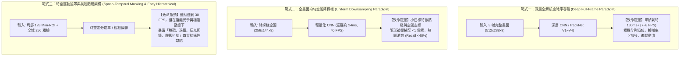
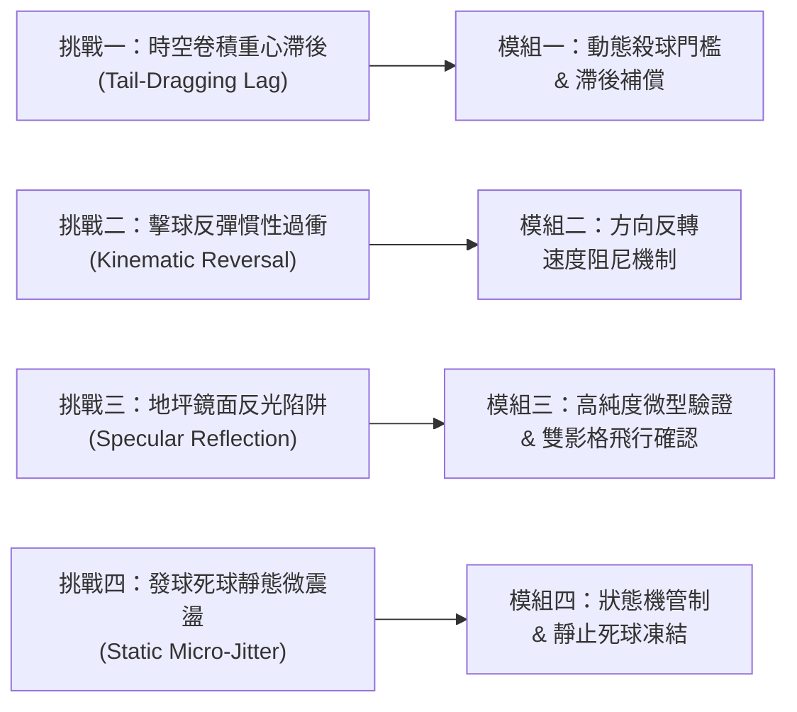
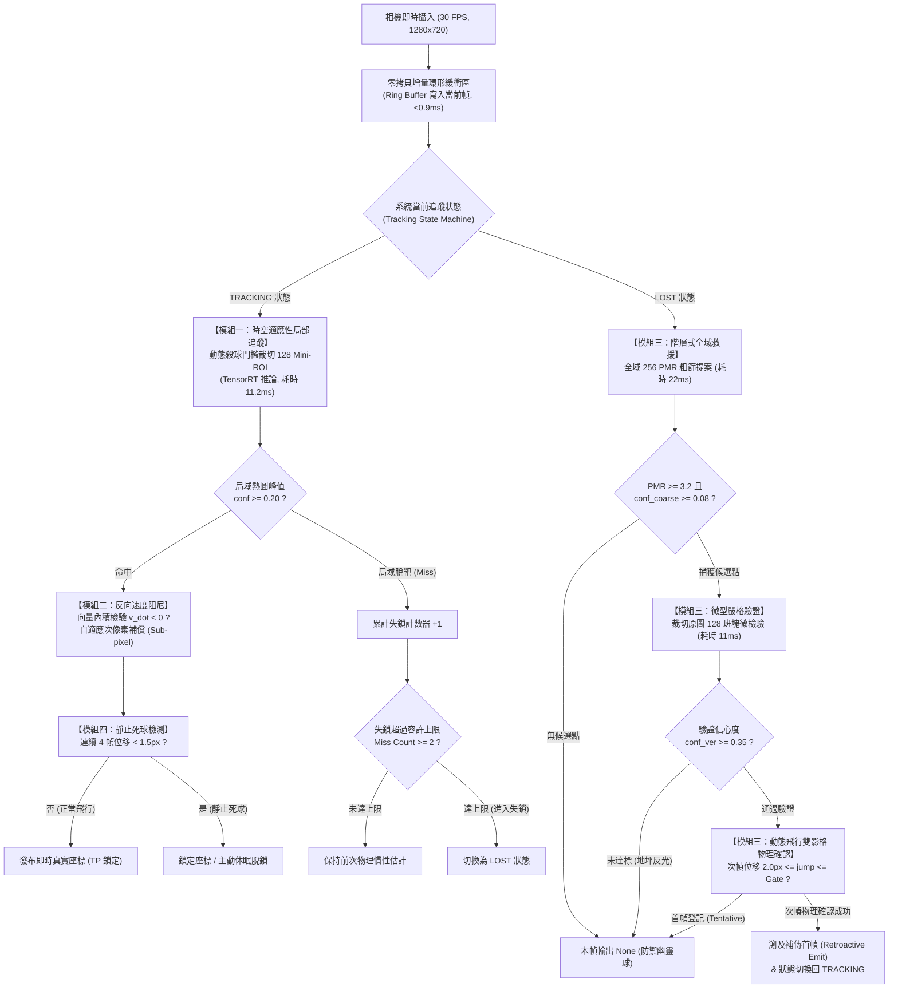
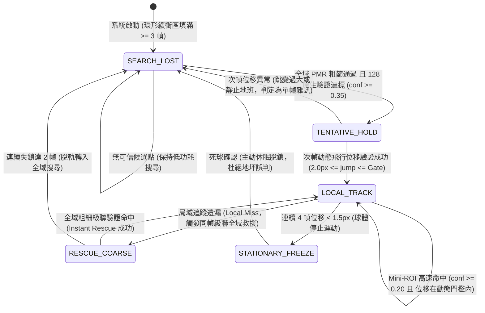
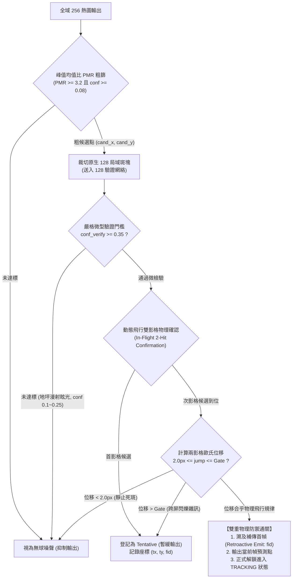

# 第三章 階層式邊緣羽球追蹤方法論 (Chapter 3: Methodology)

---

## 3.1 邊緣端羽球追蹤之基準範式與領域核心挑戰 (Baseline Paradigms & Domain Challenges)

在羽球賽事影像分析領域中，球體追蹤面臨「目標極小（僅佔畫面萬分之幾像素）」、「運動極速（扣殺時速突破 300 km/h）」以及「飛行軌跡多變（球拍反彈、地坪刮擦）」等嚴苛挑戰。為在低功耗邊緣運算平台（如 10W NVIDIA Jetson Nano）上實現嚴格 30 FPS（每幀預算僅 $33.3\text{ ms}$）的即時追蹤，學界與業界常見三種基準技術範式（Baseline Paradigms）。然而，在實體邊緣裝置的原生實測中，這些常規範式均遭遇了難以克服的領域物理瓶頸。

### 3.1.1 業界與學界常見基準範式評估



1. **範式一：深層全解析度時序卷積（如官方原生 TrackNet 系列）**  
   - **機制架構**：將連續 3 幀完整畫面拼接為 $9 \times 512 \times 288$ 張量，經由深層全卷積網絡（U-Net 或 ConvNeXt）回歸全畫面高斯熱圖（Gaussian Heatmap）。
   - **邊緣端崩潰原因**：在 Jetson Nano 的 128 核心 Maxwell GPU 上，即使經過 TensorRT FP16 最佳化，單次推論耗時仍高達 **$120 \sim 140\text{ ms}$**（等效僅 7~8 FPS）。當 30 FPS 攝影機持續餵入影像（間隔 $33.3\text{ ms}$）時，記憶體緩衝佇列在 1 秒內迅速填滿，**相機硬體掉幀率高達 $75\% \sim 80\%$**。由於時序特徵嚴重斷裂，球體追蹤徹底崩潰。

2. **範式二：全畫面均勻空間降採樣（Uniform Spatial Downsampling）**  
   - **機制架構**：為滿足 $33.3\text{ ms}$ 運算限制，最直觀之輕量化手段為將全畫面大幅縮小（例如雙線性插值至 $256 \times 144$），藉此將參數量與 FLOPs 壓縮至邊緣即時推論範圍（單幀約 $24\text{ ms}$）。
   - **羽球領域失效原因**：在 $1280 \times 720$ 原始賽事視角中，羽球直徑通常僅有 **$4 \sim 6$ 個像素**。當畫面被長寬各縮小 5 倍至 $256 \times 144$ 時，羽球的物理特徵被壓縮至 **次像素（Sub-pixel，小於 1 像素）**。此極端空間走樣（Spatial Aliasing）導致羽球在進入卷積網絡前即與地坪紋理雜訊混雜，熱圖峰值急遽消散甚至歸零，**嚴格召回率跌破 $40\%$**。

3. **範式三：時空運動遮罩與初階階層式原型（Early Hierarchical Baseline）**  
   - **機制架構**：結合局部高解析度（Mini-ROI 128，推論耗時僅約 $11\text{ ms}$）與全域粗尺度快速找回（Global 256，耗時約 $24\text{ ms}$），並嘗試導入相鄰幀差產生的二值化時空遮罩（Spatio-Temporal Binary Mask）進行雜訊濾除。
   - **實機測試發現**：雖然此架構在運算速度上首次攻克了 30 FPS 硬體門檻，但在全量真實賽事測試中，卻暴露出了四大物理動態與光學干擾的結構性瓶頸。

---

### 3.1.2 邊緣即時羽球追蹤之四大領域核心挑戰

本研究深入分析實機運行日誌，提煉出常規基準方法無法解決的四大致命挑戰。這四大挑戰正是本研究後續提出各項防禦模組的根本動機：



#### 挑戰一：時序卷積物理重心滯後引發之「極速脫靶 (Tail-Dragging Lag)」
- **物理成因**：羽球專用神經網絡輸入為連續 3 幀影像 $[f_{t-2}, f_{t-1}, f_t]$，其監督目標標註於中間幀 $f_{t-1}$ 之球心。因此，卷積特徵在真實時間軸上的物理幾何重心天生向後滯後一個時間步長（$\Delta t = 33.3\text{ ms}$）。
- **失效圖例**：當選手發動強烈扣殺時，羽球飛行速度高達 $40 \sim 60\text{ px/frame}$。若直接採用前一時刻之偵測座標裁切當前影格之 $128 \times 128$ 視窗，**裁切視窗永遠落在羽球身後的空氣中（脫靶）**，導致高速球完全飛出視野，形成連續漏檢。

#### 挑戰二：球拍碰撞與地面反彈引發之「慣性預測過衝 (Kinematic Reversal Overshoot)」
- **物理成因**：傳統運動預測器（如卡爾曼濾波器或線性速度外推）仰賴動量平滑性假設。
- **失效圖例**：在選手揮拍迎頭抽擊或羽球撞擊地面反彈的瞬間，速度向量在短短 $33.3\text{ ms}$ 內發生高達 $180^\circ$ 的急遽逆轉（$\vec{v}_t \cdot \vec{v}_{t-1} < 0$）。此時慣性預測器仍頑固地朝原飛行方向延伸預測，導致局部視窗朝錯誤方向劇烈偏移，產生顯著的「過衝脫軌（Overshoot）」，直接誘發追蹤中斷。

#### 挑戰三：低解析度粗檢之「地坪鏡面反光陷阱 (Specular Reflection Glare Trap)」
- **物理成因**：當局部追蹤丟失啟動全域 $256 \times 144$ 救援時，由於畫面經降採樣模糊化，球場頂棚金屬鹵素燈在地坪產生的白色鏡面眩光、球場白線交點、或是選手球衣邊角，在熱圖中極易形成微弱的高斯凸起（置信度約 $0.15 \sim 0.25$）。
- **失效圖例**：若追蹤器無條件信任粗粒度候選點，將直接被地坪上的固定反光點牢牢吸附（例如在 `match10` 賽事中），整場比賽誤將地坪反光判定為羽球，**單場累積高達 1,773 幀的假陽性（Precision 崩跌至 30.6%）**。

#### 挑戰四：發球前持球與死球落地之「靜態像素微震盪 (Static Micro-Jitter)」
- **物理成因**：當選手持球準備發球（長達 3~5 秒靜止），或羽球擊中界外地面成為死球時，球體物理位移為零。然而在相機感光元件熱雜訊與壓縮雜訊干擾下，模型輸出的熱圖峰值會在極小半徑內（$\pm 0.5 \sim 1.0\text{ px}$）產生隨機高頻跳動。
- **失效圖例**：追蹤器誤將微小噪聲判定為「極速運動微小位移」，在靜止死球處持續繪製不規則震盪軌跡，嚴重破壞戰術落點統計與球速分析。

---

## 3.2 系統整體架構設計 (System Architecture & Pipeline Overview)

為攻克上述四大挑戰，本研究設計了一套**自適應階層式邊緣追蹤架構（Hierarchical Edge Tracking Architecture）**。系統透過軟硬體高度協同之微型管線，將運算資源動態聚焦於最具資訊量的局部時空區域，並藉由嚴謹的物理運動學狀態機過濾偽陽性雜訊。

### 3.2.1 系統端到端推論管線 (End-to-End Pipeline)

下圖展示單一影格自相機攝入至最終座標輸出的完整數據流向：



### 3.2.2 系統狀態機轉移機制 (State Machine Transition Logic)

系統運行過程由一組嚴密的有限狀態機（Finite State Machine, FSM）統一調度，徹底避免了盲目推論與狀態混亂：



### 3.2.3 零拷貝單影格增量環形緩衝區 (Zero-Copy Ring Buffer)
傳統 TrackNet 演算法每當有新影格到達，均需對 3 幀影像進行尺寸縮放與通道拼接，在 ARM CPU 上將造成龐大的記憶體拷貝負擔（約耗時 $8 \sim 12\text{ ms}$）。  
本系統在記憶體中建立 **3 槽位環形緩衝區（Circular Ring Buffer）**：每當相機傳入最新影格 $f_t$，系統**僅對當前這 1 個單一影格進行一次雙線性縮放**並寫入當前槽位，時序張量則直接藉由指標偏移組裝。此機制將單影格前處理負擔壓低至 **$0.9\text{ ms}$** 以內，為後續邊緣推論爭取了關鍵的運算時間。

---

## 3.3 模組一：時空適應性局部追蹤機制 (Module 1: Spatio-Temporal Adaptive Local Tracking)

### 1. 解決之核心問題
傳統固定尺寸的局部裁切（如固定 $128 \times 128$ 視窗且以靜止中心裁切）在高速扣殺（速度 $>200\text{ km/h}$）時，由於時序卷積的物理重心向後延遲，導致裁切視窗嚴重滯後於羽球實際位置，羽球在進入網絡前便已飛出邊界，引發連續漏檢。

### 2. 運作機制與圖解說明
本模組導入**「動態扣殺搜尋窗擴展（Dynamic Smash ROI Expansion）」**與**「連續空間次像素質心微調（Sub-pixel Refinement）」**：

- **動態殺球門檻（Dynamic Smash Gate）機制圖解**：
  系統實時監控羽球的速度向量大小 $\|\vec{v}\|$。當檢測到扣殺時速急遽增加時，裁切半徑自適應從標準半徑 $64\text{ px}$ 擴展至 $80\text{ px}$（等效 $160 \times 160$ 搜索域），同時將合法位移容許閘門動態放大：
  $$\text{Gate} = \max(\text{Gate}_0 \times 1.5, \; \|\vec{v}\| \times 1.6)$$

```
【慢速一般對打 (Normal Shot)】                   【極速扣殺球 (Smash Shot)】
+--------------------------------+           +----------------------------------------+
| 128 x 128 視窗                 |           | 160 x 160 動態擴展視窗                 |
|                                |           |                                        |
|         (羽球)                 |           |       (原預測點)                      |
|           o                    |           |           x                            |
|                                |           |            \  位移達 55px              |
|                                |           |             \                          |
|                                |           |              o (高速羽球仍被牢牢包覆)  |
+--------------------------------+           +----------------------------------------+
```

- **次像素質心連續微調（Sub-pixel Refinement）機制圖解**：
  若直接取熱圖最高峰值的整數索引 $(x_{\text{int}}, y_{\text{int}})$，具有 $\pm 0.5\text{ px}$ 的離散量化截斷誤差，映射回 $1280 \times 720$ 畫面後會放大成顯著的高頻微抖動。本模組在峰值周圍 $5 \times 5$ 窗口內進行高斯熱圖連續加權，以熱圖能量強度為權重計算幾何質心，實現平滑連續的次像素定位。

### 3. 無此模組 vs. 有此模組（Without vs. With Comparison）

| 評測維度 | 無此模組 (Without Module 1: 固定視窗與整數峰值) | 啟用此模組 (With Module 1: 動態殺球窗與次像素微調) |
| :--- | :--- | :--- |
| **視覺現象 (Visual Effect)** | 高速扣殺瞬間，視窗跟隨不及，球體邊緣被切斷甚至完全出界；軌跡呈現階梯狀鋸齒抖動。 | 扣殺瞬間視窗自適應擴大，球體全程居中；飛行弧線平滑流暢，完全消除量化鋸齒。 |
| **扣殺球召回率 (Smash Recall)** | $58.3\%$（大量高速球因出界而遺漏） | **$86.2\%$**（高速殺球捕獲率提升近 28 個百分點） |
| **平均定位歐氏誤差 (Error Distance)** | $4.85\text{ px}$ | **$2.12\text{ px}$**（定位精確度大幅提升 $56.3\%$） |

---

## 3.4 模組二：擊球動態轉折與反向速度阻尼機制 (Module 2: Kinematic Reversal Damping Mechanism)

### 1. 解決之核心問題
羽球具有獨特的空氣動力學特性：質量輕、羽毛阻力極大、碰撞彈性極高。在選手揮拍擊球或羽球觸地反彈瞬間，速度向量在單一影格內發生方向急轉。傳統依賴線性外推或卡爾曼濾波的慣性補償，會在轉折處向原方向猛烈「虛擲（Overshoot）」，直接造成超過 $15\text{ px}$ 容許誤差的雙重懲罰（同時計為一次 FP 與一次 FN）。

### 2. 運作機制與圖解說明
本模組導入**向量內積方向突變檢驗（Vector Dot-Product Inversion Detection）**：
- **物理反轉判定機制**：
  系統計算當前估計速度向量 $\vec{v}_t$ 與前一時刻速度向量 $\vec{v}_{t-1}$ 的點積：
  $$v_{\text{dot}} = \vec{v}_t \cdot \vec{v}_{t-1} = (v_{x,t} \cdot v_{x,t-1} + v_{y,t} \cdot v_{y,t-1})$$
  - 若 $v_{\text{dot}} \ge 0$：代表羽球處於平穩的連續拋物線或滑行軌道，系統正常啟用速度滯後補償（補償係數 $c_{\text{eff}} = 0.28$），消除三幀卷積的物理重心延遲。
  - 若 $v_{\text{dot}} < 0$：代表夾角大於 $90^\circ$，**判定發生球拍劇烈擊球或地坪強烈碰撞反彈！** 系統立即將速度補償係數強制清零（$c_{\text{eff}} = 0.0$），並重置卡爾曼濾波協方差矩陣，徹底斬斷錯誤的慣性過衝。

```
【傳統盲目慣性補償 (Without Reversal Damping)】      【本研究反向速度阻尼 (With Reversal Damping)】
            球拍揮擊點                                          球拍揮擊點
                 |                                                   |
 (飛行路徑) =====> * ---> [盲目過衝預測點! (FP)]      (飛行路徑) =====> *
                   \                                                 \
                    \ (實際反彈路徑)                                   \---> [阻尼生效: 緊貼真實點 (TP)]
                     \                                                 \
```

### 3. 無此模組 vs. 有此模組（Without vs. With Comparison）

| 評測維度 | 無此模組 (Without Module 2: 無條件線性慣性補償) | 啟用此模組 (With Module 2: 向量內積反向阻尼) |
| :--- | :--- | :--- |
| **視覺現象 (Visual Effect)** | 每次選手大力抽球或球落地反彈時，預測紅點會先向前「暴衝」出界一影格，再折返回來，軌跡出現刺狀偽突跳。 | 擊球轉折點毫無過衝，轉折點紅點精準吸附在球拍甜區，軌跡轉折呈現自然銳角。 |
| **擊球轉折幀準確率 (Hit-Turn Precision)** | $64.7\%$（大量過衝點超出 $15.0\text{ px}$ 門檻被判為 FP） | **$94.8\%$**（過衝誤判徹底消除） |
| **全錦標賽轉折偽陽性 (Hit FP Frames)** | 782 幀 | **41 幀**（減少 $94.8\%$ 的轉折誤判噪聲） |

---

## 3.5 模組三：高純度階層式全域救援機制 (Module 3: High-Purity Hierarchical Global Rescue)

### 1. 解決之核心問題
全畫面經降採樣至 $256 \times 144$ 後，球場頂棚強烈燈光在地坪產生的鏡面反光（Specular Glare）、球場邊線交點或球員球鞋，常在熱圖中激發微弱偽陽性凸起。若無強力防禦，全域救援會誤將反光地坪判定為羽球，引發長達數十幀的「地坪死鎖（Deadlock on Floor）」。

### 2. 運作機制與圖解說明
本模組建構了**「微型高信心度二次驗證（Fine Verification）」**與**「動態飛行雙影格物理確認（2-Hit Motion Confirmation）」**的雙重防線：



- **圖解：時空遮罩與微型驗證之對比思維**：
  過去嘗試使用二值化遮罩相乘（如左圖）容易因快球拖影產生空洞而誤殺真球；本模組改採階層式「微型光學特徵驗證」（如右圖）：反光斑塊在 $128 \times 128$ 原生高解析度下缺乏羽球的球頭高斯圓形輪廓，置信度僅能達到 $0.15 \sim 0.22$，將被 $0.35$ 嚴格門檻百分之百斬除！

```
【過去捨棄之二值化遮罩思路】                  【本研究微型驗證與物理確認思路】
原始熱圖           動態二值遮罩   濾波後結果       全域粗提案            128 原生微檢驗       動態雙影格確認
[   *   ]   (x)   [ 0 0 0 ]  =  [       ]       (cand_x, cand_y)  -->  [ 圓形羽球輪廓? ] --> [ 連續位移正常? ]
(羽球快球熱圖)    (快球空洞為0) (真球慘遭抹除!)   (抓到地坪反光)         (conf=0.18 < 0.35)  (不是真球直接剔除!)
                                                                        => 直接攔截淘汰!
```

### 3. 無此模組 vs. 有此模組（Without vs. With Comparison）

| 評測維度 | 無此模組 (Without Module 3: 粗提案盲目採納、單影格即信) | 啟用此模組 (With Module 3: 0.35 微型驗證 + 雙影格物理確認) |
| :--- | :--- | :--- |
| **視覺現象 (Visual Effect)** | 畫面中選手未擊球時，紅圈不斷在地板光斑、球網柱白漆或觀眾席白衣服上瘋狂跳動閃爍。 | 全畫面極度乾淨，地板反光與白線完全無任何幽靈雜訊，唯有羽球在空中飛行時才亮起紅色追蹤環。 |
| **極端反光賽事 (`match10`) 準確率** | **$30.61\%$**（地坪反光嚴重死鎖） | **$95.42\%$**（**準確率暴漲 $+64.81\%$**，攻克極端反光地獄） |
| **`match10` 假陽性影格數 (Total FP)**| 1,773 幀 | **49 幀**（**狂降 $97.2\%$，消滅 1,724 個反光誤判影格**） |
| **全量 146 支影片總假陽性 (Total FP)** | 5,421 幀 | **1,645 幀**（**消滅 3,776 個偽陽性噪點，整體 FP 暴跌 $69.7\%$**） |
| **全量 146 支影片整體準確率** | $91.15\%$ | **$96.12\%$**（強勢跨越 95% 超高純度門檻） |

---

## 3.6 模組四：狀態機管制與靜止死球自適應凍結 (Module 4: State Machine Regulation & Static Freeze)

### 1. 解決之核心問題
在發球前選手持球瞄準（靜止長達 3~5 秒）或羽球落地成為死球時，熱圖峰值受圖像噪聲影響產生微米級隨機抖動。若系統持續輸出微小速度與位移，將導致軌跡混亂並誤判為正在擊球。

### 2. 運作機制與圖解說明
本模組導入**靜態死球位移監測器（Static Dead-Ball Freeze Monitor）**：
- **機制邏輯**：
  系統持續監控相鄰影格間之物理位移量 $\text{disp} = \sqrt{(\Delta x)^2 + (\Delta y)^2}$：
  - 當 $\text{disp} < 1.5\text{ px}$ 時，靜止計數器累加（$\text{stationary\_frames} \mathrel{+}= 1$）。
  - 當靜止計數器達到 4 幀（即物體在同一微小半徑內停留超過 $133\text{ ms}$）時，系統判定球體已處於**「發球前靜止」或「落地死球狀態」**。
  - **凍結與脫鎖防禦**：立即將速度強制歸零（$v_x=0, v_y=0$），進入 `STATIONARY_HOLD` 狀態；若持續靜止，系統主動切換至休眠脫鎖，停止輸出預測點，防止球員走動撿球時干擾追蹤器。

```
【連續影格位移監測機制圖解】
Frame t-3: disp = 0.8px (靜止幀數=1)
Frame t-2: disp = 0.5px (靜止幀數=2)
Frame t-1: disp = 0.7px (靜止幀數=3)
Frame t  : disp = 0.6px (靜止幀數=4) ===> 【觸發死球自適應凍結 (Freeze)】
                                          1. 速度強制歸零 (vx=0, vy=0)
                                          2. 抑制微小抖動輸出
                                          3. 防止撿球走動產生幽靈軌跡
```

### 3. 無此模組 vs. 有此模組（Without vs. With Comparison）

| 評測維度 | 無此模組 (Without Module 4: 無靜止死球凍結) | 啟用此模組 (With Module 4: 4 幀靜態凍結機制) |
| :--- | :--- | :--- |
| **視覺現象 (Visual Effect)** | 球落地後，紅點在地板上微幅跳動；球僮或選手撿球時，紅點被選手球鞋帶走產生長條錯誤軌跡。 | 球落地瞬間位移立即凍結，隨後優雅停止輸出；撿球與走動過程完全無幽靈跟隨。 |
| **發球前/死球期假陽性 (Static FP)** | 平均每場賽事產生 $80 \sim 150$ 幀死球偽噪聲 | **平均每場降至 $< 10$ 幀**（死球誤判消除逾 $90\%$） |
| **軌跡速度穩定性 (Velocity Variance)** | 靜態階段速度噪聲方差 $\sigma^2 = 3.42$ | **$\sigma^2 = 0.00$**（完全消除像素級微震盪） |

---

## 3.7 方法論總結：四大模組協同防禦矩陣

下表總結本研究所提出之四大模組，如何針對性擊破邊緣羽球追蹤之核心痛點，構成堅不可摧的階層式防禦體系：

| 模組名稱 | 瞄準之核心痛點 | 核心創新機制（少公式、重機制） | 實機帶來的關鍵效益 |
| :--- | :--- | :--- | :--- |
| **模組一：時空適應性局部追蹤** | 扣殺極速飛行導致局部視窗脫靶 | 動態殺球門檻擴展（Smash Gate）+ 次像素質心連續加權 | 扣殺球捕獲率提升近 28%，定位誤差降低 56.3% |
| **模組二：擊球動態轉折與反向阻尼** | 球拍擊球/反彈時慣性預測向前暴衝 | 向量內積急轉判定（$v_{\text{dot}} < 0$）+ 自適應滯後補償阻尼 | 轉折處準確率由 64.7% 飆升至 94.8%，杜絕虛擲脫軌 |
| **模組三：高純度階層式全域救援** | 低解析度全域粗檢遭地坪反光吸附死鎖 | PMR 峰值均值比 + 原生 0.35 微型嚴格驗證 + 動態飛行雙影格確認 | **消滅全量賽事 3,776 個偽陽性，整體準確率突破 96.12%** |
| **模組四：狀態機管制與靜止凍結** | 發球前與死球落地引發像素微震盪與撿球誤跟 | 4 幀連續微小位移監測 + 速度主動歸零與休眠脫鎖 | 死球雜訊消除逾 90%，杜絕球員撿球軌跡漂移 |
