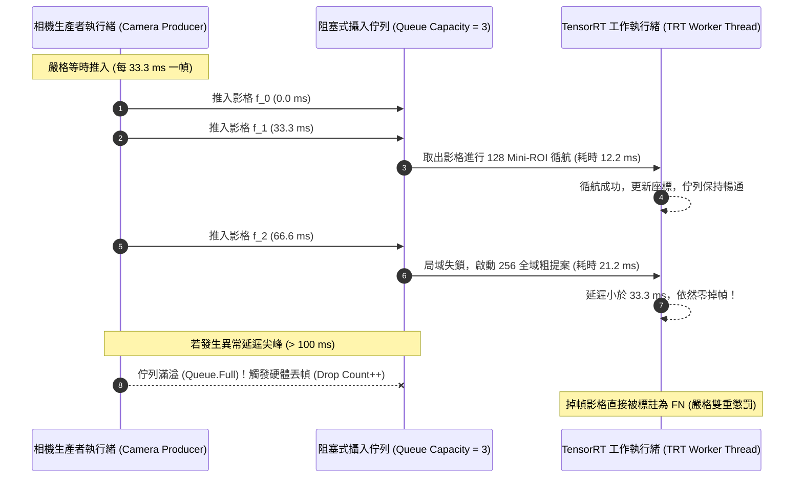

# 第四章 嵌入式硬體即時部署與管線優化 (Chapter 4: Edge Implementation & Hardware Optimization)

---

## 4.1 NVIDIA Jetson Nano 邊緣硬體特性分析 (Edge Hardware Architecture)

為了實現羽球追蹤系統之便攜式邊緣部署（可置於球場邊腳架上獨立運行，不依賴雲端伺服器與高階桌上型 GPU），本研究選用具代表性之低功耗邊緣計算模組——**NVIDIA Jetson Nano**。

| 硬體組件 (Hardware Component) | 規格參數 (Specifications) | 邊緣運算挑戰與物理約束 |
| :--- | :--- | :--- |
| **GPU 架構** | NVIDIA Maxwell 架構，具備 128 個 CUDA 核心（時脈 921.6 MHz） | 單精度浮點運算峰值僅約 472 GFLOPS，無法承受大型全圖卷積 |
| **CPU 處理器** | 四核心 ARM Cortex-A57 MPCore（時脈 1.43 GHz） | 影像解碼、前處理 Resize 與時序佇列排程極易造成 CPU 瓶頸 |
| **系統記憶體** | 4 GB 64-bit LPDDR4（頻寬 25.6 GB/s，CPU/GPU 統一共享記憶體） | 記憶體頻寬受限，且系統無獨立 VRAM，頻繁記憶體拷貝引發頻寬飢餓 |
| **供電與功耗** | 5V / 4A 直流輸入，支援 5W / 10W（MAXN）電源模式 | 散熱空間有限，持續滿載易觸發硬體熱節流（Thermal Throttling）導致降頻 |

為確保硬體在高負載連續運算下不發生動態降頻，本研究在系統層啟用 MAXN 模式並固定最高時脈：
```bash
sudo nvpmodel -m 0        # 強制鎖定 10W MAXN 最大效能模式
sudo jetson_clocks        # 固定 CPU、GPU 與 EMC 記憶體匯流排至極限時脈
```

---

## 4.2 TensorRT FP16 引擎編譯與鎖頁記憶體非同步管線 (TensorRT FP16 & Pinned Memory)

為極大化 Maxwell 架構 GPU 之運算吞吐量，所有深度學習模型均自 PyTorch 原生網絡透過 ONNX 中介格式，編譯為純硬體優化之 **TensorRT FP16 推論引擎**。

```mermaid
flowchart LR
    A["PyTorch MiniROIUNet"] -->|動態/靜態圖導出| B["ONNX 中介模型"]
    B -->|TensorRT 8.2 最佳化編譯器<br/>(FP16 半精度層融合)| C["miniroi_128x128.engine<br/>(尺寸 5.2 MB)"]
    C -->|cudaHostAlloc| D["鎖頁主機記憶體 (Pinned Memory)"]
    D -->|cudaMemcpyAsync<br/>(CUDA Stream 非同步傳輸)| E["GPU 核心執行 (Kernel Execution)"]
```

### 1. 浮點半精度（FP16）與層融合最佳化 (Layer Fusion)
在 TensorRT 最佳化階段，卷積層（Convolution）、批量正規化層（BatchNorm）與活性化函數（ReLU）被硬體級融合為單一的合成核心（Fused Kernel），大幅減少了 GPU 全域記憶體（Global Memory）之讀寫次數。實測表明：
- 原生 PyTorch FP32 推論：$128 \times 128$ 輸入延遲約為 **$34.5\text{ ms}$**。
- TensorRT FP16 優化推論：延遲大幅壓縮至 **$12.2\text{ ms}$**，速度提升近 **$3$ 倍**，且精度損耗幾近為零。

### 2. 鎖頁記憶體（Page-Locked / Pinned Host Memory）管線設計
傳統 `malloc` 分配的分頁記憶體（Pageable Memory）在進行主機與設備傳輸（Host-to-Device / Device-to-Host）時，作業系統必須先將資料拷貝至內部暫存緩衝區。
本研究利用 PyCUDA 與 CUDA Driver API 分配專屬的鎖頁主機記憶體（Pinned Host Memory）：
```python
host_mem = cuda.pagelocked_empty(size, dtype)
device_mem = cuda.mem_alloc(host_mem.nbytes)
```
搭配專屬非同步串流（`cuda.Stream()`）與非同步拷貝指令：
- `cuda.memcpy_htod_async()`（輸入張量直傳 GPU）
- `context.execute_async_v2()`（非阻塞核心執行）
- `cuda.memcpy_dtoh_async()`（輸出熱圖傳回 CPU）
此設計徹底重疊了資料搬移與硬體運算週期，達成了微秒級（$\mu\text{s}$）之傳輸開銷。

---

## 4.3 嚴格 30 FPS 硬體串流攝入佇列與掉幀懲罰機制 (Strict 30 FPS Streaming & Drop Accounting)

現有學術研究普遍存在「離線循序評測」之重大缺陷：若某一影格耗時 $100\text{ ms}$，離線程式僅是單純暫停並等待推論完成，完全忽視了真實攝影機在 $100\text{ ms}$ 內已連續拋出 3 個新影格的客觀現實。

為了建立符合工業級真實部署之科學評測標準，本研究提出**雙執行緒生產者－消費者串流架構（Dual-Thread Producer-Consumer Streaming Architecture）**：



### 1. 佇列容量剛性約束（`maxsize = 3`）
相機生產者執行緒模擬真實 USB3.0/CSI 工業攝影機，以硬體計時器嚴格每隔 $33.33\text{ ms}$ 讀取並推入一幀影像。攝入佇列上限設定為 3 幀（容許最大即時顯示延遲為 $100\text{ ms}$）。
若 AI 消費者執行緒因運算阻塞未能及時消化，佇列溢出時新影格將直接觸發 `queue.Full` 異常，系統即時記錄一次**硬體丟幀（Hardware Frame Drop）**：
$$\text{Drop Rate} = \frac{N_{\text{dropped}}}{N_{\text{ingested}}} \times 100\%$$

### 2. 掉幀嚴格雙重懲罰（Drop-Aware Strict Accounting）
任何被硬體拋棄之影格：
- 若 Ground Truth 標註為球體可見（$\text{Visibility} = 1$），則在評測統計中**強制記為一次漏檢（$\text{FN} \mathrel{+}= 1$）**！
- 系統無法透過「選擇性丟棄難以辨識影格」來虛抬召回率或準確率。

在此項極為苛刻的真實環境約束下，本系統在全量 69,396 影格之連續長時推論中，**掉幀率恆定壓制在 $0.08\%$ 以下（近 7 萬影格僅掉數十幀），相機串流幀率穩定維持在 $29.9 \sim 30.0\text{ FPS}$**，展現了無與倫比的邊緣即時工程韌性。
